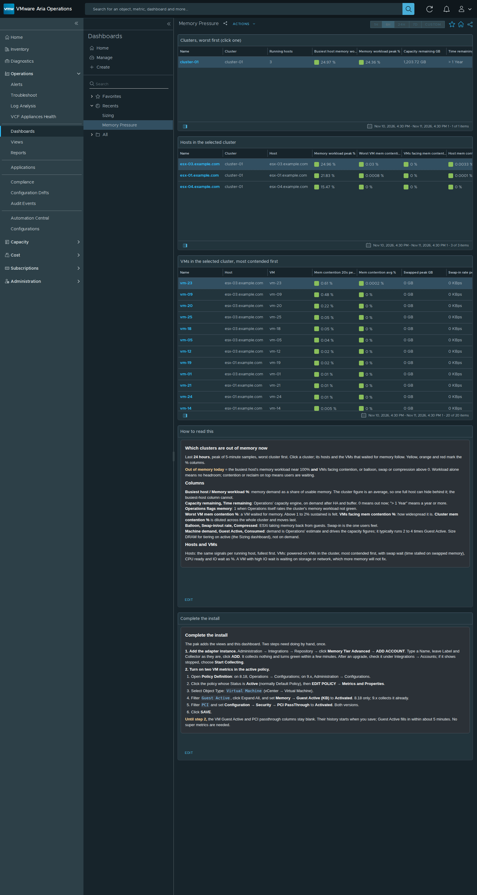
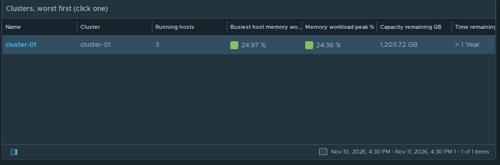
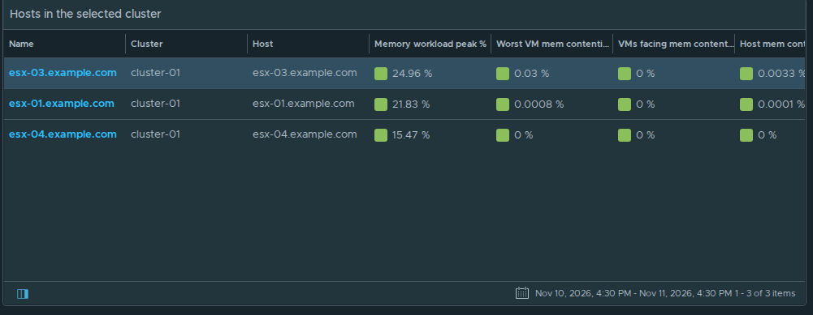
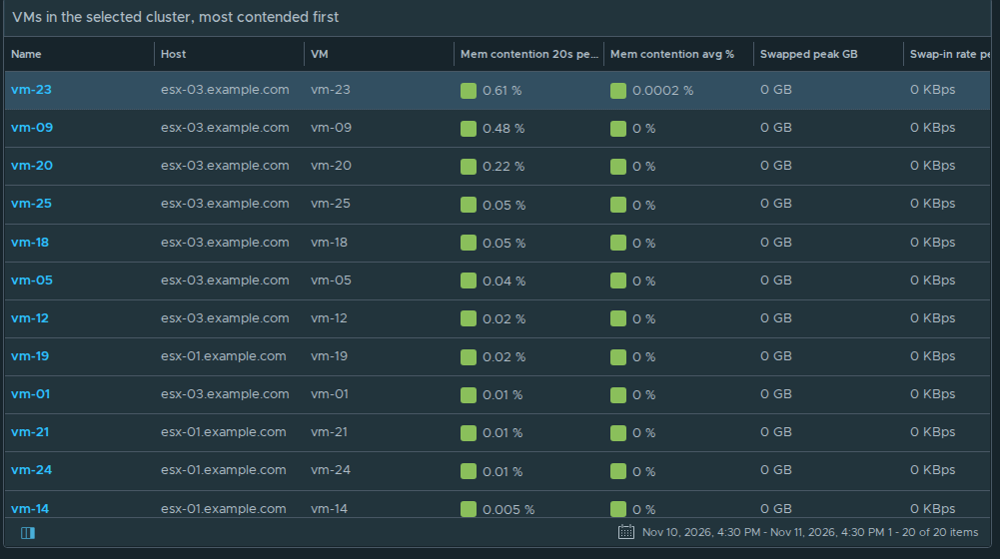
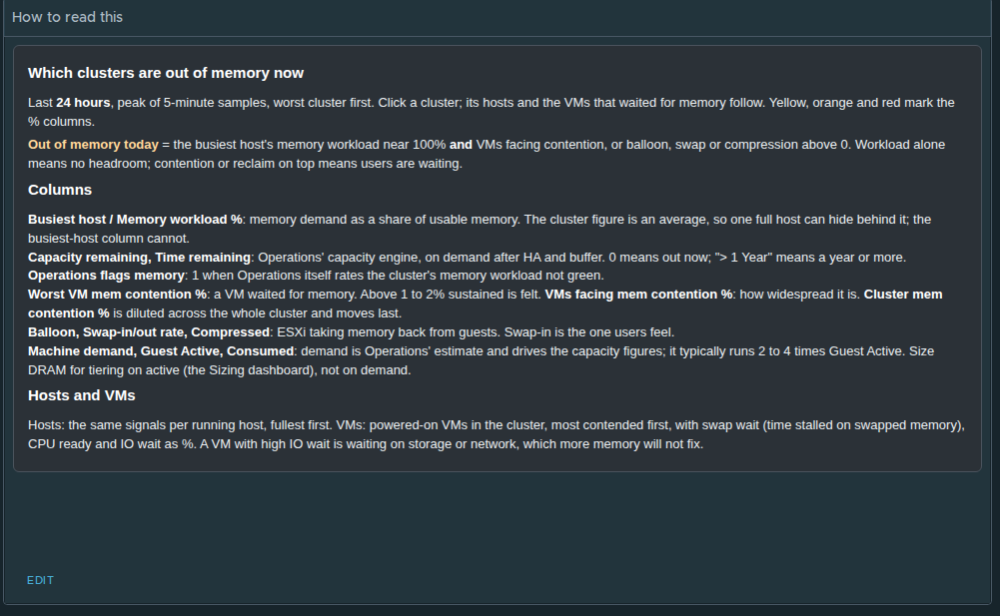
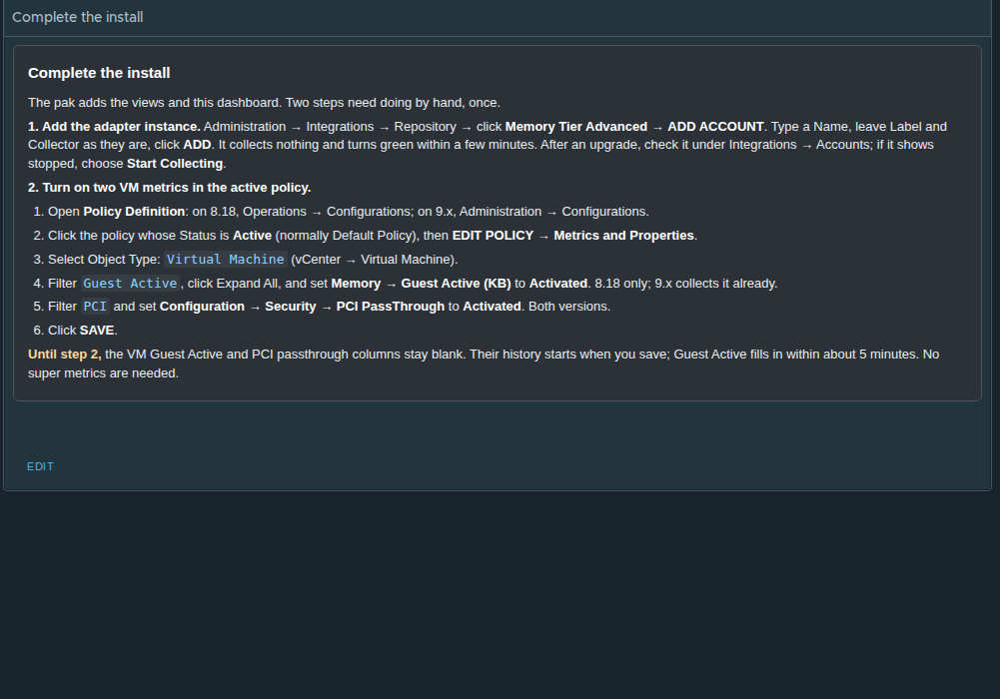

# Memory Tier Advanced › Memory Pressure

Which clusters are **out of memory now**. Every column covers the **last 24 hours** (peak of 5-minute samples); tables open worst first, and the % columns turn yellow, orange and red. **Click a cluster**; its running hosts and the VMs that waited for memory follow. The two text panels at the bottom explain each column and list the steps the pak can't do by itself.

The text of both panels is in [text-panels.txt](text-panels.txt). The same cluster table ships as the report **Memory Tier Advanced - Cluster Memory Pressure** (PDF and CSV): Reports, run it on vSphere World or schedule it.

Screenshots: Aria Operations 8.18.7, v3.0.0-rc.4, lab data (no cluster on the lab is short of memory, so every cell is green). Object names are replaced: `cluster-01`, `esx-NN.example.com`, `vm-NN`.

## Clusters, worst first (click one)

Busiest host memory workload % (sorted on this), cluster memory workload %, Operations' capacity remaining and time remaining, its own non-green flag, memory contention (worst VM, % of VMs, cluster), balloon, swap-in and swap-out rates, compressed, and machine demand beside Guest Active and consumed.

All 19 columns: [1-clusters-all-columns.png](1-clusters-all-columns.png)

## Hosts in the selected cluster

Running hosts, fullest first: memory workload %, contention, reclaim, demand, active, consumed and usage.

All 14 columns: [2-hosts-all-columns.png](2-hosts-all-columns.png)

## VMs in the selected cluster, most contended first

Powered-on VMs: memory contention (20-second peak and average), swapped, swap-in, compressed, swap wait %, memory workload %, configured GB, CPU ready and IO wait %.

All 12 columns: [3-vms-all-columns.png](3-vms-all-columns.png)

## How to read this

## Complete the install

