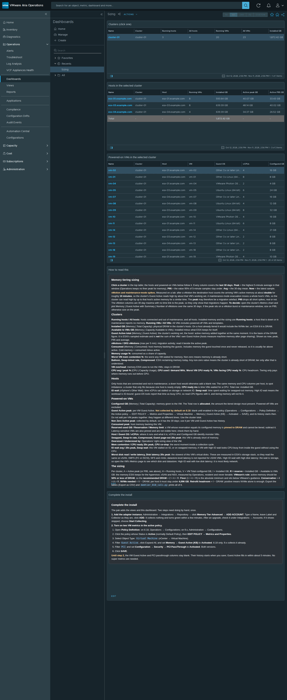
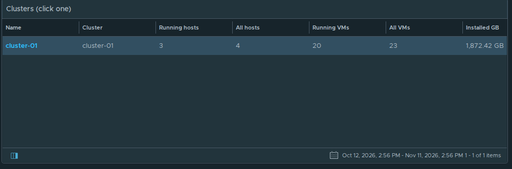
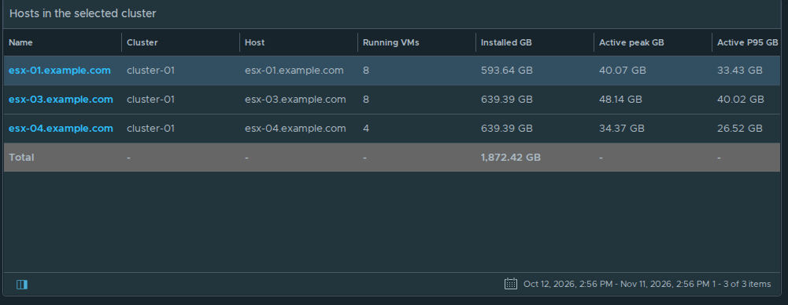
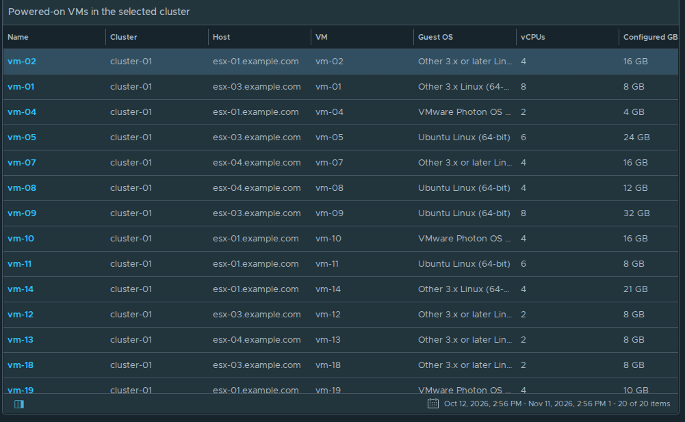
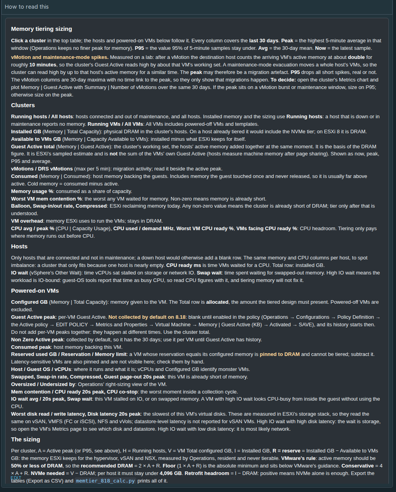
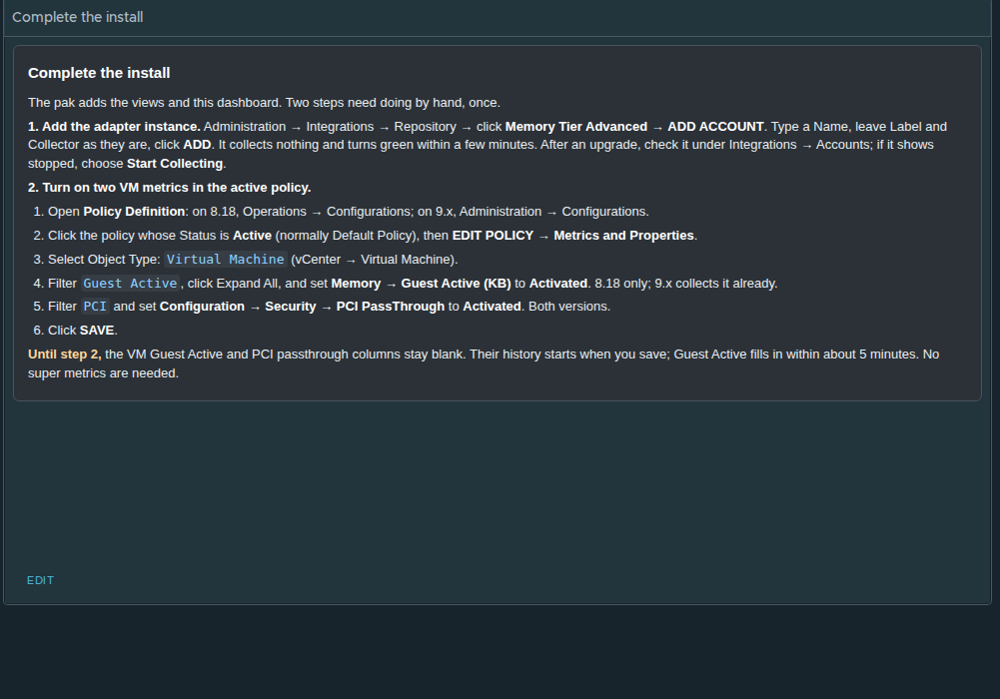

# Memory Tier Advanced › Sizing

The pack's dashboard. **Click a cluster** in the top table; its running hosts and powered-on VMs follow. Every column covers the last 30 days. The two text panels at the bottom explain each column and list the steps the pak can't do by itself.

The text of both panels is in [text-panels.txt](text-panels.txt).

Screenshots: Aria Operations 8.18.7, rc.3 (pak 0.0.0.3), lab data. Object names are replaced: `cluster-01`, `esx-NN.example.com`, `vm-NN`.

## Clusters (click one)

Sizing inputs per cluster: running and all hosts and VMs, installed and available memory, Guest Active (now, peak, P95, average), vMotions, consumed, memory pressure, VM overhead and CPU headroom.

All 28 columns: [1-clusters-all-columns.png](1-clusters-all-columns.png)

## Hosts in the selected cluster

Running hosts only (connected, not in maintenance). The same memory and CPU columns per host, to spot imbalance, plus CPU ready, IO wait and swap wait.

All 19 columns: [2-hosts-all-columns.png](2-hosts-all-columns.png)

## Powered-on VMs in the selected cluster

Per VM: configured memory, Guest Active, Non Zero Active, consumed, the exclusions Operations can see (reservation, limit, PCI passthrough), memory pressure, right-sizing, CPU ready, co-stop, IO wait, swap wait and worst virtual-disk latency. Total rows: configured GB and reserved GB.

All 29 columns: [3-powered-on-vms-all-columns.png](3-powered-on-vms-all-columns.png)

## How to read this

## Complete the install

